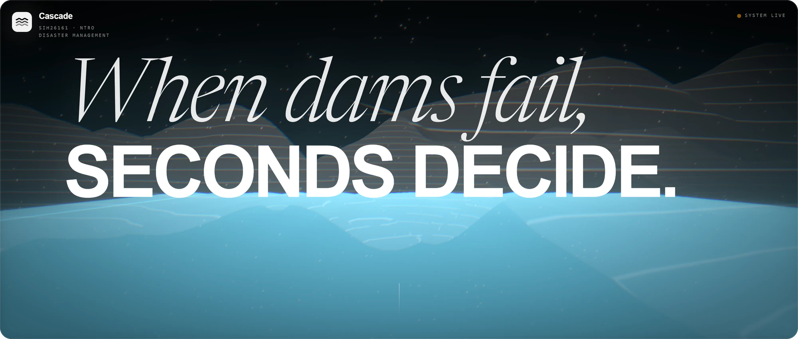
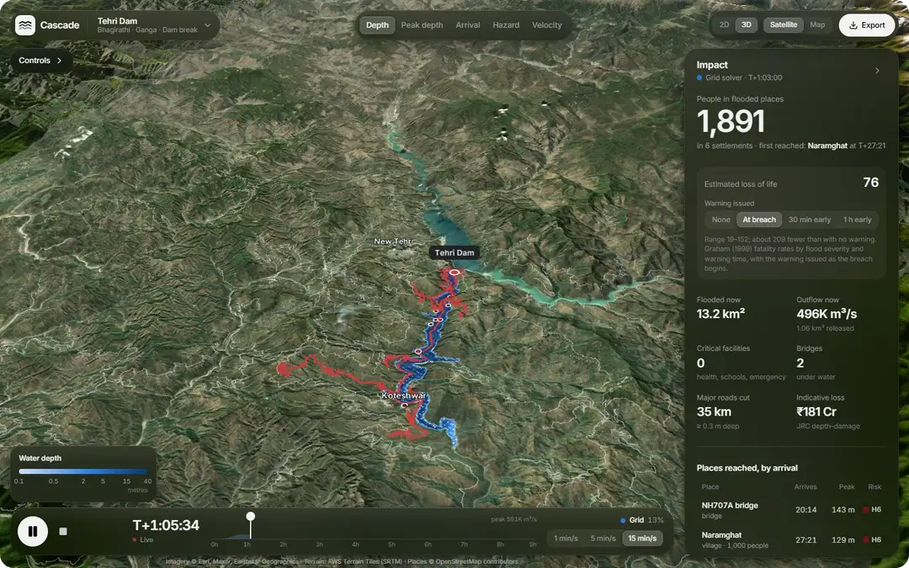
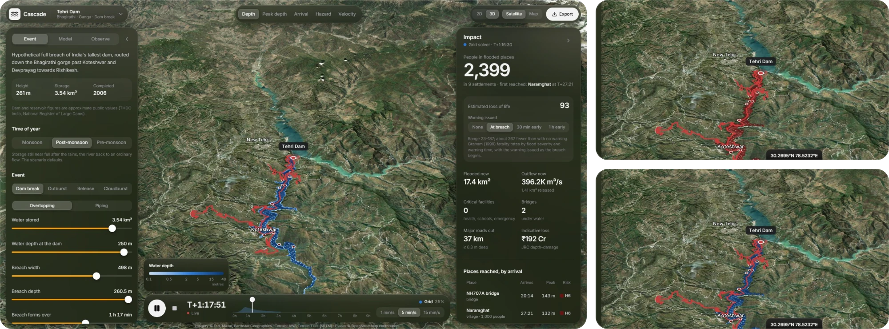

 

  <b>Cascade</b> shows a district what a dam failure would do, before it ever happens: 
  where the water goes, when it arrives, how deep it gets, and who is standing in its way.

  

  Smart India Hackathon 2026&ensp;·&ensp;Problem SIH26161&ensp;·&ensp;National Technical Research Organisation

 

Tehri Dam, full breach. The flood is worked out live, in the browser, as it plays.

 

<h3 align="center">The first hours, on one screen</h3>

  Pick any of 144 Indian dams, choose how it fails, and watch the flood run down the real valley, minute by minute. 
  Arrival times, depths and the people in the water update as it moves.

 
 

<h3 align="center">Two solvers. One honest answer.</h3>

  Cascade works out the same flood with two independent methods. 
  Where they agree, the answer holds. Where they disagree, the gap is drawn on the map, 
  so uncertainty is never hidden behind one confident colour.

 

<h3 align="center">Not only dams</h3>

  Glacial-lake outbursts, controlled releases and cloudbursts run on the same engine, 
  over real terrain, real roads and real settlements, from Tehri to the 1979 Machchhu II failure at Morbi.

 

<h3 align="center">Built to be trusted, not to impress</h3>

  Every number on screen carries its caveat. Cascade is a planning and exercise tool for the people 
  who write evacuation plans. It is not a forecast and not an official warning.

 
 

  
    
  Runs entirely in the browser. Next.js, deck.gl, MapLibre and WebGPU.
   
  © 2026 Dhruv Sonar. All rights reserved.

